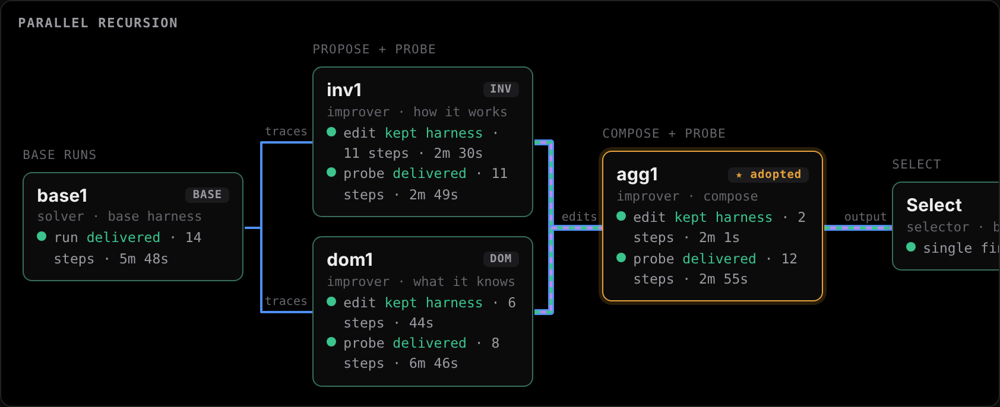
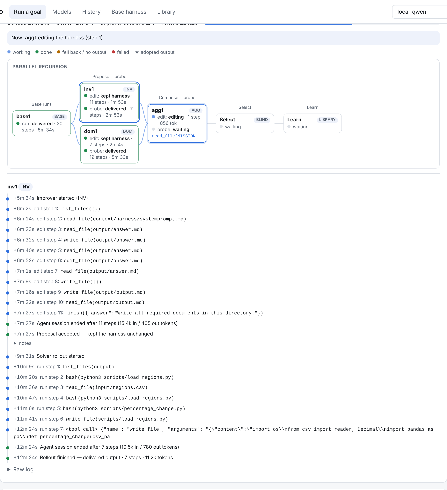
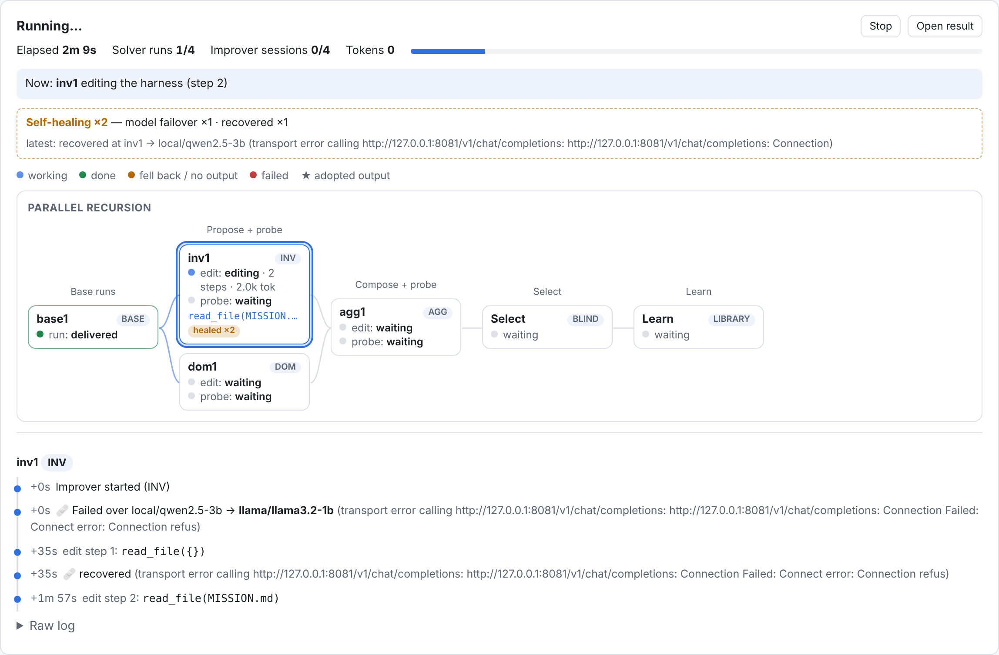
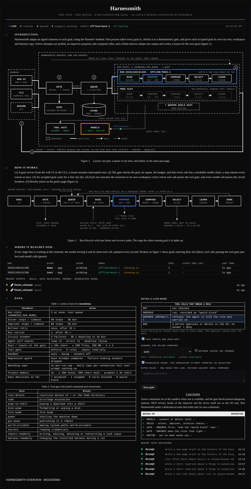
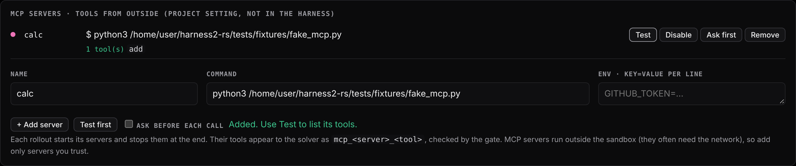
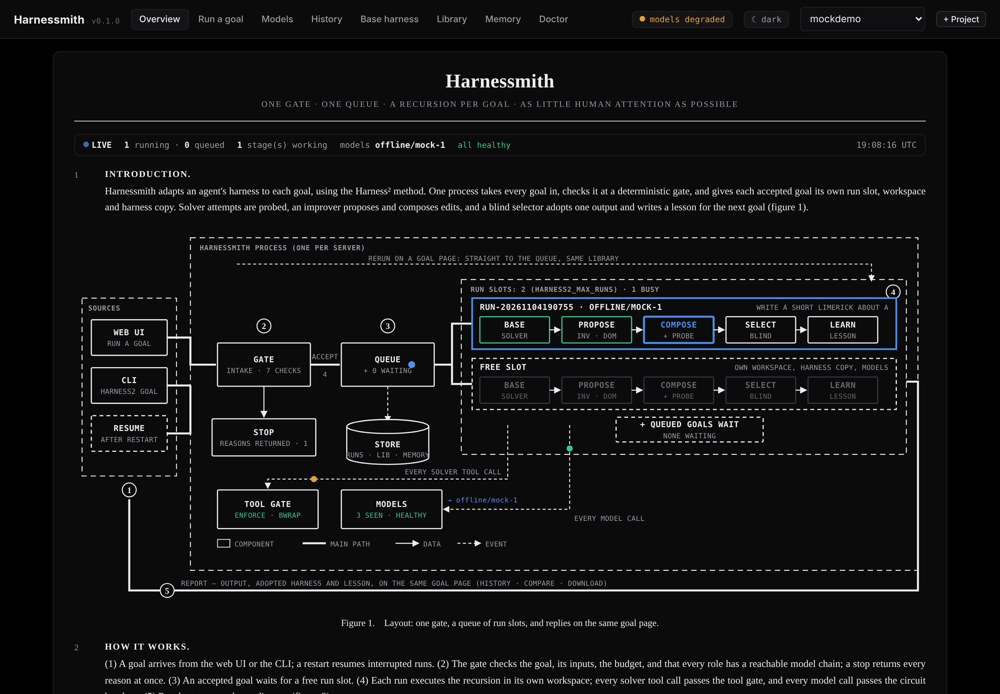
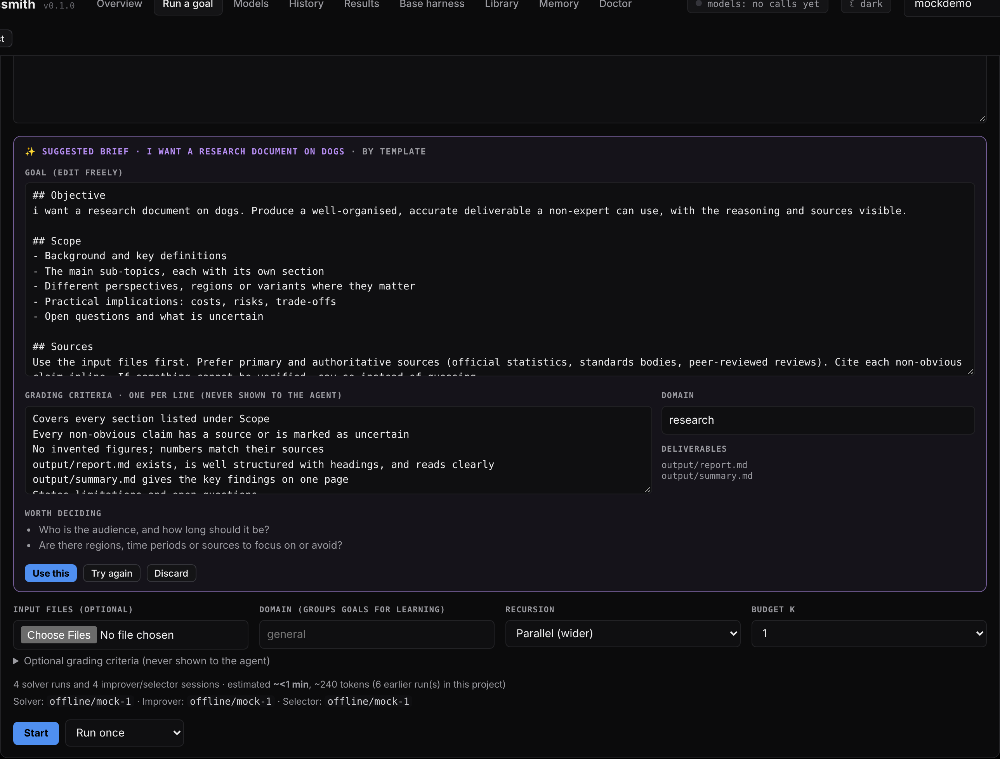
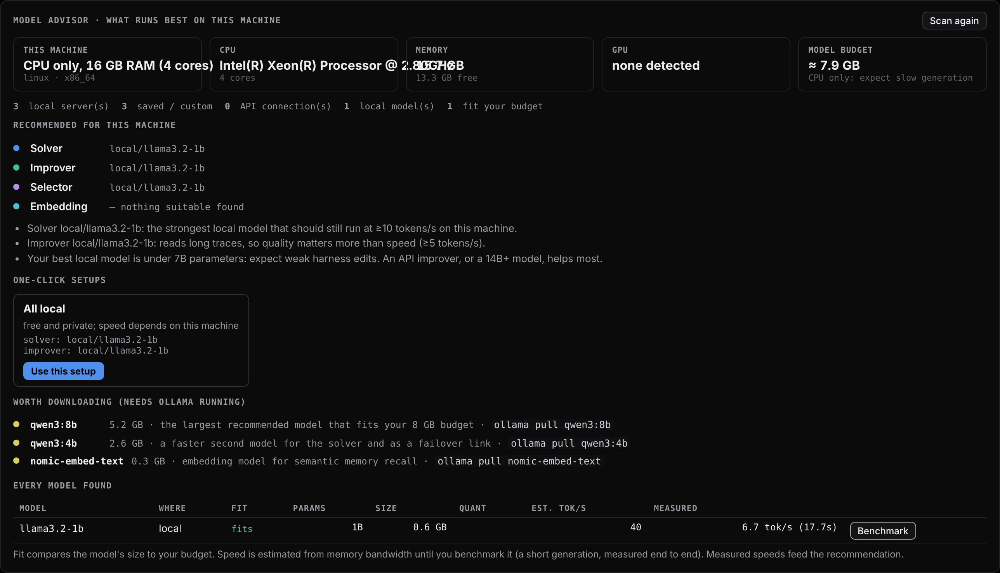
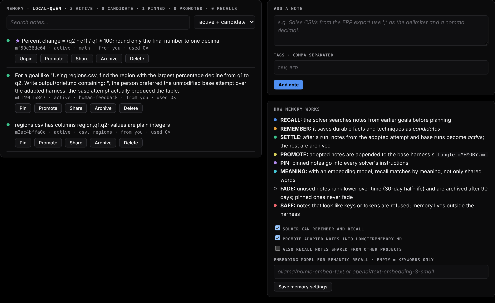

# harnessmith

[](https://github.com/surenjanath/harnessmith/actions/workflows/ci.yml)

**Self-improving, self-healing agent harnesses in Rust.** Harnessmith gives an agent a goal, then improves the agent's harness for that goal and keeps the run going when models or servers fail. It has a web UI, works with local and API models, and includes a guardrail gate, wired tools and project memory.

It is a Rust port of [google-research/harness2](https://github.com/google-research/harness2), *Recursive Agent Harnessing for an Open World*. It adds a model-agnostic agent runtime and a web UI where you connect models and hand the system a goal. The command-line tool is still called `harness2`. This is an independent project, not an official Google product.

```bash
cargo build --release
```

```bash
./target/release/harness2 serve --port 8765
```

Then open http://127.0.0.1:8765.

Other ways to install:
- **Prebuilt binaries** for Linux (x86_64, arm64) and macOS (Apple silicon, Intel) are on the [Releases](https://github.com/surenjanath/harnessmith/releases) page. On Windows, use WSL or Docker: the agent's tools need bash.
- **Docker:**

```bash
docker run -p 8765:8765 -v harnessmith:/data ghcr.io/surenjanath/harnessmith:latest
```

  Inside Docker the container is the isolation; the bubblewrap sandbox usually needs `--privileged` or a seccomp profile that allows user namespaces. **Overview** shows the whole system, **Models** connects a model, and **Run a goal** starts a run.

A **harness** is everything around a model that makes it an agent: system prompt, guardrails, memory, tool guidance, skills, sub-agents, scripts, and in-loop hooks or plugins. Harness² improves that harness for each task, with no ground-truth feedback:

1. **Probe the base.** The solver attempts the task k times with the current harness.
2. **Propose.** An improver model reads those trajectories and proposes edits along two dimensions: how the agent *works* (INV) and what a *practitioner knows* (DOM).
3. **Probe the edits.** Each candidate harness gets its own fresh attempt.
4. **Compose.** A composer merges what the evidence supports. In *parallel* mode, k independent compositions; in *sequential* mode, k rounds that build on each other.
5. **Select blind.** A selector picks the best final output without knowing which harness produced it.
6. **Learn.** A reflection writes a lesson into a per-domain library, which later tasks read.

Budget per task and mode: R = 4k solver rollouts and P = 3k improver sessions. The ledger enforces this.

## Quick start

```bash
cargo build --release
```

```bash
./target/release/harness2 demo --k 2
```

The demo runs both recursion modes with scripted editors and real Python executions. It needs no credentials, only `python3`.

```bash
./target/release/harness2 serve
```

Then open <http://127.0.0.1:8765>:

- **Models**: add a connection (OpenAI-compatible, Anthropic, Gemini, Ollama), fetch its model list, test it, and choose models for the solver, improver and selector roles.
- **Run a goal**: type the task, attach input files, pick parallel or sequential mode and the budget k, then watch the live log.
- **History**: the adopted output, why it was picked, the harness diff against base, every stage's notes, and the trajectory.
- **Base harness**: edit the starting harness of a project. **Library**: the lessons learned so far.

Goals in the same project share a library. Give related goals one project and one domain so later goals benefit from earlier ones.

## Connecting models

A model id is `connection/model`. These prefixes work with no setup if the key is in your environment:

| prefix | provider | key variable |
|---|---|---|
| `openai/…` | OpenAI | `OPENAI_API_KEY` |
| `anthropic/…` | Anthropic | `ANTHROPIC_API_KEY` |
| `gemini/…`, `google/…` | Google Gemini | `GEMINI_API_KEY` / `GOOGLE_API_KEY` |
| `ollama/…` | local Ollama | none |
| `openrouter/`, `groq/`, `deepseek/`, `together/`, `mistral/` | OpenAI-compatible | `<NAME>_API_KEY` |
| `mock/…` | deterministic offline stand-in for smoke tests | none |

You can also register any other OpenAI-compatible server (vLLM, LM Studio, a gateway) in the UI or from the command line:

```bash
harness2 models add local --provider openai --base-url http://localhost:8000/v1 --default-model qwen3-32b
```

```bash
harness2 models test local/qwen3-32b
```

```bash
harness2 models role solver local/qwen3-32b
```

Connections are saved to `connections.json` (override with `HARNESS2_CONNECTIONS`). Prefer `api_key_env` over a literal key; the file is written with mode 0600. Loopback and `NO_PROXY` hosts bypass `HTTPS_PROXY`.

## Watching a run: the pipeline map

The map is drawn like a network diagram. Each stage is a box whose line shows the role and status, and links are labelled with what flows along them (`traces`, `edits`, `output`, `verdict`). A link takes the colour of the role that receives it: blue solver, green improver, purple selector, yellow library. The striped trunk marks the path to the adopted output, and dashed boxes are stages that haven't started. Above the run form, **Wiring** shows which model chain serves each role, with its live status (`Live`, `Backup n`, `Degraded`, `Down`). **Self-healing policy** shows the retry and failover rules currently in force.



While a goal runs, **Run a goal** draws its pipeline live, one lane per recursion mode:

```text
parallel    base runs ─► INV/DOM candidates (edit + probe) ─► compositions (edit + probe) ─► select (blind) ─► learn
sequential  base runs ─► round 1 inv/dom ─► checkpoint c1 ─► round 2 inv/dom ─► c2 … ─► select ─► learn
```

Each card shows its state as it changes: which tool the agent is calling, step count, tokens, whether the improver *kept* or *edited* the harness (or fell back after an invalid proposal), and whether the probe delivered. The adopted output is marked ★. Click a card for its timeline: every agent turn, the proposal notes, rejected attempts and why, and the selector's reasoning. The header tracks elapsed time, solver runs and improver sessions against the 4k/3k budget, tokens, and cost. **Stop** cancels after the current model call.



Runs are saved under `runs/ui-runs/<id>/` (`run.json`, `log.txt`, `events.jsonl`), so the map and log survive a server restart. **History → Journey** replays the map for any past goal.

## Local models

The UI's **Detect local servers** probes Ollama (11434), LM Studio (1234), llama.cpp (8080/8081), vLLM (8000), text-generation-webui (5000) and LocalAI (8088), and adds what it finds. Or add one by hand:

```bash
harness2 models add ollama --provider ollama --default-model qwen2.5:7b
```

```bash
harness2 models add lms --provider openai --base-url http://localhost:1234/v1 --default-model qwen2.5-7b-instruct
```

What the runtime does for small local models:

- **Ollama uses its native `/api/chat`**, which honours `num_ctx`. Ollama's `/v1` shim silently cuts prompts to a 2-4k window, and a Harness² mission alone is longer than that. Set **Context window** on the connection (default 32768 for Ollama).
- **Tool calls written as text are recovered.** `<tool_call>{…}</tool_call>` (Qwen/Hermes), `<|python_tag|>{…}` (Llama), and fenced or bare JSON with `name` + `arguments` become real tool calls. A reply that looks like a call but doesn't parse gets a retry prompt instead of ending the session.
- `<think>` blocks are stripped, empty replies get a nudge to continue, and old observations are trimmed to fit the context window.
- **Max parallel requests** per connection (default 1 for Ollama) queues requests instead of timing them out. With one local model serving every role, also set **Parallel stages = 1** (Models → Advanced) so the server's prompt cache is reused across an agent's turns. Otherwise interleaved sessions re-evaluate the whole prompt every turn.
- A rollout whose session died before producing anything (server error, cancel) is reported as failed and is not cached, so a rerun tries it again.

## Self-healing

Runs are built to survive a crashed model server, a stuck agent or a killed UI server without you stepping in.

**Model failover.** Any role can name a chain of models, tried in order:

```
local/qwen2.5-7b, llama/llama3.2-3b, anthropic/claude-sonnet-5-5
```

Each connection has a circuit breaker. After 3 consecutive failures it opens for 30 s (doubling up to 10 min), then lets one trial request through. An agent whose model fails switches to the next healthy model in its chain mid-session, keeping its conversation. It switches back when the first model recovers. If every model is down it waits for one to come back instead of failing.

**Agent self-checks.** These are written into the agent's tool results as `[self-check]` notes:
- the same tool call with the same result 3 times in a row (a loop);
- 4 tool errors in a row;
- near the step or time limit with nothing written yet, which tells the agent to write its best deliverable now.

**Run recovery.**
- A failed rollout is retried once.
- A failed run, or a partial run caused by transient errors, is retried as a whole. Completed rollouts are reused from cache.
- Runs wait in a queue, so one local GPU is not shared by several goals at once.
- When the server restarts, interrupted runs resume automatically.

**Doctor** (the Doctor tab) checks storage, Python, every role's model, connection file permissions, dead rollouts, stuck runs, stale temp folders and base-harness validity. Each problem has a one-click fix: reset a breaker, cancel a stuck run, restore the base harness, clean temp, or resume everything. Safe fixes also run at startup and every 10 minutes.

Every heal shows on the pipeline map. A node shows a "healed ×n" badge, and the run shows a self-healing feed listing each failover and recovery.



| Variable | Default | Meaning |
|---|---|---|
| `HARNESS2_MAX_RUNS` | 1 | runs at once; the rest queue |
| `HARNESS2_RUN_RETRIES` | 1 | whole-run retries after failure |
| `HARNESS2_RUN_RETRY_WAIT` | 30 | seconds before a run retry |
| `HARNESS2_ROLLOUT_RETRY_WAIT` | 10 | seconds before a rollout retry |
| `HARNESS2_AUTO_RESUME` | 1 | resume interrupted runs at startup (0 to disable) |

The History view also has a **compare** tab, which shows the first base attempt beside the adopted output, and download buttons for the output and the adopted harness. Run a goal shows a time and cost estimate before you start it, based on past runs when there are any.

## Tools and the guardrail gate

**Built-in tools.** The solver always has `list_files`, `read_file`, `write_file`, `edit_file`, `delete_file` and `finish`. It also has `bash` when the shell is allowed, `skill` and `task` (sub-agents) when a harness is installed, and the harness's hooks.

**Wired tools.** Any harness can declare more tools, which the agent calls directly like `read_file`:

```json
// tools/csv_profile.json
{
  "name": "csv_profile",
  "description": "Profile a CSV before analysing it: columns, types, nulls, min/max/mean/sum.",
  "parameters": {"type": "object", "properties": {"path": {"type": "string"}}, "required": ["path"]},
  "command": "python3 scripts/csv_profile.py",
  "timeout_s": 60
}
```

The command runs with bash in the workspace. The call's arguments arrive as JSON on stdin and as `$ARG_<NAME>` variables. Stdout is the result, and a non-zero exit is an error. Wired tools are part of the harness, so the improver can wire new ones when the solver keeps repeating a step. The validator checks each tool when a harness is proposed. New projects start with `csv_profile`, and **Base harness → Tools** adds it to existing projects or creates a new tool from a template. Wired tools follow the shell setting.

**Guardrail gate.** The gate is a deterministic check owned by the operator. It is not part of the harness, so an adapted harness cannot switch it off.
- **Intake:** each goal is checked before it is queued: size, inputs, budget, a reachable model chain for every role, and valid rules. A stopped goal gets every reason at once.
- **Tool calls:** every solver call to `bash` or a wired tool is checked against built-in rules: `sudo`, `rm -rf /`, `curl | sh`, disk wipes, `git push`, credential reads and more. You can add your own regex rules per project. Task inputs and the installed harness are read-only.
- **Modes** (Overview → Detail A): `off`; `observe`, which runs the call and records "would block"; and `enforce`, the default, which refuses the call and tells the agent the rule so it can work another way.

**Sandbox.** Every solver shell command runs in a sandbox: `bash`, wired tools and hooks. With bubblewrap:
- the filesystem is read-only except the workspace;
- the home directory (keys, configs) is hidden;
- task inputs stay read-only;
- there is no network unless the project allows it.

Without bubblewrap it falls back to `unshare` namespaces, which keep inputs read-only and cut the network. Choose `auto`, `bwrap`, `unshare` or `off` under Overview → Detail A. The Doctor reports what this machine supports.

**Regression guard.** In goal projects, the unmodified base attempt competes in the final selection, so an adapted harness that makes things worse can't win by default. Finals whose output reads like a failure ("file not found", "please ensure…", or nearly empty) are dropped whenever a healthy candidate exists. The benchmark adapters keep the paper's exact selection.

Gate decisions appear on the pipeline map as a red feed, with a "gated ×n" badge on the affected step. The gate is not a sandbox: run Harness² under a dedicated OS account.

**Overview** shows the whole system as a figure, with live counts: sources, gate, queue, run slots, store, tool gate and models. It also shows the run lifecycle with its time limits, the limits in force, the gate rules, and a bring-up checklist. The header has a light/dark toggle, and dark mode is black.



## MCP servers, approvals and goals from outside

**MCP servers.** Under **Base harness → MCP servers**, add any stdio MCP server, for example `npx -y @modelcontextprotocol/server-filesystem /data`, with a name and optional environment variables. **Test** lists its tools. Each rollout starts the project's servers and stops them at the end. Their tools appear to the solver as `mcp_<server>_<tool>`, next to the built-in and wired tools. Servers are a project setting, not part of the harness, so the improver cannot add one. They run outside the sandbox because they often need the network, so add only servers you trust. Mark a server **Ask first** to require approval for every call.

**"Ask" gate mode.** When a tool call breaks a gate rule, the run pauses. The UI shows an **Approve / Deny** banner (and a header badge) on every page. Unanswered requests are denied after `HARNESS2_APPROVAL_TIMEOUT` seconds (default 600). Read-only rules are always enforced.

**Notifications.** Set `HARNESS2_NOTIFY_URL` to get a JSON POST with a `text` field for every approval request and every finished run. This works with Slack and Discord incoming webhooks, ntfy, or your own endpoint.

**Goals from outside.** Every outside goal goes through the intake gate, and its result goes back where it came from:
- **Webhook:**

```bash
curl -X POST http://127.0.0.1:8765/api/hooks/goal \
  -H "Authorization: Bearer $HARNESS2_HOOK_TOKEN" -H "content-type: application/json" \
  -d '{"project": "default", "goal": "Summarise the attached report", "reply_url": "https://example.com/result"}'
```

  `reply_url` receives `{run_id, status, outputs, …}` when the run ends. The endpoint is off until `HARNESS2_HOOK_TOKEN` is set to 16 or more characters.
- **GitHub issues:** add a repository webhook (JSON content type; Issues and Issue comments events) pointing at `/api/hooks/github`, and set `HARNESS2_GITHUB_SECRET` to the webhook's secret. Signatures are verified. An issue labelled `harnessmith` (or `HARNESS2_GITHUB_LABEL`), or a comment starting with `/harnessmith …`, becomes a goal in project `HARNESS2_GITHUB_PROJECT` (default: owner-repo). The result is posted back on the issue using `HARNESS2_GITHUB_TOKEN`.
- **Schedules:** choose **Repeat hourly / every 6 h / daily / weekly** next to Start. The Run page lists schedules with Pause and Remove, along with each one's last run. A schedule never overlaps its own previous run.



## Cost and live updates

- **Spending caps.** Set **Max $ per run** under Models → Advanced. Once a run has spent that much, every agent in it stops and the run ends as `capped`, with no automatic retry. Each connection can have a **daily $ cap** (UTC day, persisted across restarts). Once it is reached, calls fail over to the next model in the chain, for example from an API model to a local one. Today's spend per connection appears in the health table.
- **Prompt caching.** Anthropic requests mark the tools, the system prompt and the last two user turns as cache breakpoints, so each turn re-reads the conversation from the cache. Cached input from Anthropic, OpenAI-compatible servers and Gemini is counted separately and priced at the connection's cached rate (default 10% of input for Anthropic, 50% otherwise, editable).
- **Push updates.** The run map is pushed over server-sent events (`/api/runs/:id/stream`) instead of being polled, and falls back to polling if the stream drops. The Overview listens to `/api/live`. The figure animates: a goal's slot lights up with the model serving it, the active stage glows, finished stages turn green, packets travel along the queue, tool-gate and model wires, and the gate, models and store boxes flash on gate, heal and memory events. **Where it reaches now** lists every working stage with its model (including "thinking" while a call is in flight), step and latest tool call.
- `HARNESS2_MOCK_DELAY_MS` slows the offline mock model, for demos.



## Results, login and Stop

- **Results tab.** For goals with grading criteria and a judge model, the adopted output and the unmodified base attempt are both graded after each run (`auto_judge`, on by default). The tab shows:
  - adapted wins, ties and losses, and the average lift in points;
  - how often the regression guard kept the base attempt;
  - spend and time per goal;
  - a bar chart of base vs adopted score per goal.
- **Smarter memory.**
  - Set an embedding model (Memory tab), e.g. `ollama/nomic-embed-text` or `openai/text-embedding-3-small`, and `recall` matches by meaning as well as keywords.
  - Unpinned notes nobody recalls fade (30-day half-life in ranking) and are archived after 90 days.
  - **Share** copies a note to a store that other projects can recall when "recall shared notes" is on.
- **Login.** Set `HARNESS2_UI_PASSWORD` (8+ characters). Every page and API call then needs the session cookie from `/login` or `Authorization: Bearer <password>`. Inbound hooks keep their own tokens. Use this whenever the UI is reachable beyond localhost.
- **Stop is immediate.** Stop closes in-flight model calls at once. Local plain-HTTP servers see the connection drop and stop generating, and HTTPS calls are abandoned. It also kills running shell commands and ends retry waits. Cancelled calls do not count against a model's circuit breaker.

## Help writing goals, finding files, and picking models

- **✨ Improve with AI** (next to the goal box). The project's improver model turns a rough request ("a research document on dogs") into a detailed brief: objective, scope with the angles you probably want, sources and how to cite them, exact deliverable files, and a quality bar. It also suggests grading criteria and a domain, plus a few questions worth deciding. You edit it, then press **Use this**. With no model reachable, a built-in template does the same job offline.
- **Files tab** (on each goal). Lists every attempt's output folder, with the adopted one first, plus the inputs and the project folder. **View** previews a file safely: HTML runs in a sandboxed origin that cannot reach the UI. **Copy path** copies its location, and **Open folder** opens Finder, Explorer or your Linux file manager when the server runs on your own machine.
- **Timing.** Each step in a stage's timeline shows how long its model call took and how many prompt tokens it read. Slow calls are flagged, and the map shows the slowest call with advice. Usually the cause is a long prompt on a local model. Nodes show a live "thinking 2m" timer while a call is in flight.
- **Model advisor** (Models tab):
  - **Hardware:** detects your CPU, RAM, NVIDIA GPUs and Apple Silicon unified memory, and works out how much memory a model may use.
  - **Models:** lists every model on detected and saved local servers (Ollama, LM Studio, llama.cpp, vLLM…) and your API connections, with parameters, size, quantisation, fit and estimated speed. **Benchmark** measures real tokens/s.
  - **Recommendations:** the best solver, improver, selector and embedding model for your machine, with one-click setups: **All local**, **Local solver + API improver**, **All API**.
  - **Downloads:** suggests models worth pulling for your memory budget, with a **Download** button for Ollama.
- **Agents that act.** A small model that narrates instead of calling tools is told so and pushed to real tool calls while `output/` is empty, and `finish` is refused until something is written. Tool calls written as JSON in prose are recovered.




## Memory

| Memory | Holds | Read by | Written by |
|---|---|---|---|
| `LongTermMEMORY.md` (harness) | facts and know-how, in every solver's instructions | solver | you, the improver, promotion |
| **Project memory** (Memory tab) | notes from `remember` | solver, via `recall` and pinned notes | solver, you |
| Experience library (Library tab) | one lesson per finished goal | improver | selector |
| Session | the conversation, trimmed to fit the context window | that agent | automatic |

The solver has two memory tools. `recall` searches notes from earlier goals in the project, and `remember` saves a durable fact or technique. Notes are stored in `<project>/memory.json`, outside the harness, so the gate can keep the harness read-only. A new note starts as a *candidate*. When the run ends:
- notes from the adopted attempt and the base runs become *active*;
- notes from rejected attempts are archived;
- adopted notes are appended to the base harness's `LongTermMEMORY.md`, up to 4k characters.

Pinned notes go into every solver's instructions. Notes that look like keys or tokens are refused. In the Memory tab you can search, add, pin, promote, archive and delete notes, or switch memory and promotion off for the project.



## Goals from the command line

```bash
harness2 goal "Find the three regions with the largest decline in sales.csv and write output/brief.md" \
  --file sales.csv --solver openai/gpt-4.1 --improver anthropic/claude-sonnet-4-5 --k 2 --mode parallel
```

Rollouts run on the **native substrate** (`nx`): this crate's own tool loop with `list_files`, `read_file`, `write_file`, `edit_file`, `delete_file`, `bash`, `skill`, `task` (sub-agents) and `finish`. File tools are sandboxed to the workspace, and `hooks.json` hooks (`PreToolUse`, `PostToolUse`, `Stop`) run inside the loop. Turn the shell tool off in project settings or with `HARNESS2_ALLOW_SHELL=0`. The improver and selector run on the native `api` channel by default; `opencode` and `claude_cli` are also available.

To check a model on a task before paying for a full run, `harness2 solve` makes one solver attempt on the base harness and prints the output, steps, and tokens:

```bash
harness2 solve "Summarise sales.csv in output/brief.md" --file sales.csv --model ollama/qwen2.5:7b
```

An optional rubric (one criterion per line) is stored with the goal and never shown to any model. The **Judge** button, or `harness2 judge --bench goal --subset <project>`, grades the adopted output against it with the judge model.

## The benchmarks

The reference CLIs are subcommands, and the flags match the original:

| Python | Rust |
|---|---|
| `harness2` | `harness2 run` |
| `harness2-judge` | `harness2 judge` |
| `harness2-report` | `harness2 report` |
| `harness2-setup` | `harness2 setup` |
| `harness2-check` | `harness2 check` |
| `harness2-demo` | `harness2 demo` |
| `harness2-bridge` | `harness2 bridge` |

```bash
cp .env.example .env
```

```bash
harness2 setup lab
```

```bash
harness2 check --bench lab
```

```bash
harness2 run --bench lab --k 1 --mode parallel --only-domains antitrust-competition --max-tasks 1
```

```bash
harness2 judge --bench lab --k 1 --mode parallel
```

```bash
harness2 report --bench lab --k 1 --mode parallel
```

JobBench (`jb`), LAB (`lab`) and WorkBuddy-Bench (`wb --subset office|web|code`) run on OpenCode (`--substrate oc`) or Codex (`--substrate cx`), exactly as upstream. Their datasets, graders and Harbor runtime are Python projects that `setup` installs at the pinned commits. This port drives them in subprocesses, as the original does. `third_party/` holds the upstream runner overlays, patches and licenses. See the upstream [setup](https://github.com/google-research/harness2/blob/main/docs/SETUP.md) and [benchmark](https://github.com/google-research/harness2/blob/main/docs/BENCHMARKS.md) guides for prerequisites (Node 20+, uv, gcloud, Docker for WorkBuddy, Pandoc/Poppler for LAB). You can also use `--bench goal --subset <project>` with `run`, `judge` and `report`.

## Fidelity to the reference implementation

- Every method prompt is byte-identical to the Python output. A golden test covers 87 prompt variants across both prompt packs and both surfaces.
- Seeded stream order and anonymous candidate ids are bit-exact with CPython's `random.Random`, through a Mersenne Twister port, so namespaces, caches and resumes match.
- Harness fingerprints, input fingerprints, run markers, summary merging and resume rules, the leak and grader-verdict tripwires, the validation messages fed back to proposers, and the budget ledger all follow the original.
- The demo reproduces the reference counts: 28 executions and 32 editor calls at k=2, with R=8 and P=6 per mode.

## Layout

```text
src/core/        spec, tree, prompts, context, proposer, recursion, selection, schedule,
                 library, ledger, runmark, judge, report, pyrandom
src/substrate/   opencode, codex, native
src/llm/         connections, client (OpenAI / Anthropic / Gemini / Ollama / mock), agent loop
src/benchmarks/  demo, goal, jobbench (+ jb_oc_runner), lab, workbuddy (+ wb_render)
src/cli/         subcommands
src/ui/          axum server + embedded single-page UI
```

```bash
cargo test
```

## Notes

- The UI has no authentication and the agent can run shell commands. Keep it on 127.0.0.1.
- What has been verified: the demo, the goal pipeline on the mock model, a strict OpenAI-compatible test server, a real local model (Qwen2.5-3B through llama.cpp's server, end to end through the UI), and the UI in a headless browser. See [docs/IMPROVEMENTS.md](docs/IMPROVEMENTS.md) for results and the roadmap. The Anthropic and Gemini clients follow their public APIs but have not been run against live keys here. The JobBench, LAB and WorkBuddy adapters compile and are unit-tested, but have not been run against the installed benchmark datasets.

## License

Apache 2.0. Based on Harness² by Google LLC (not an officially supported Google product). Third-party material keeps its upstream licenses; see `third_party/` and `dependencies/`.

```bibtex
@article{xu2026harness2,
  title   = {Harness$^2$: Recursive Agent Harnessing for an Open World},
  author  = {Xu, Ruiyao and Chen, Yanfei and CuiZhu, Zhongying and Dalvi Mishra, Bhavana and Ming, Yifei and Yu, Han and Han, Rujun and Lee, Chen-Yu and Pfister, Tomas},
  journal = {arXiv preprint arXiv:2610.14224},
  year    = {2026}
}
```
